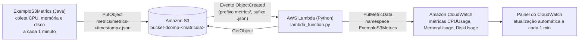

# ExemploAWSLambda

Função **AWS Lambda em Python** que recebe o JSON de métricas gravado no S3 pelo
[ExemploS3Metrics](https://github.com/tarcisiodarocha/ExemploS3Metrics) e publica **uso de CPU, memória e disco**
no **Amazon CloudWatch**. Um painel do CloudWatch mostra os três valores num gráfico atualizado a cada minuto.

Este README é um **tutorial completo pelo console web da AWS**, pensado para o **AWS Academy Learner Lab**.

---

## Sumário

0. [Visão geral](#0-visão-geral)
1. [Arquivos do repositório](#1-arquivos-do-repositório)
2. [O que muda no AWS Academy](#2-o-que-muda-no-aws-academy)
3. [Iniciar o Learner Lab](#3-iniciar-o-learner-lab)
4. [Passo 1: bucket S3 (chegada do JSON)](#4-passo-1-bucket-s3-chegada-do-json)
5. [Passo 2: criar a função Lambda](#5-passo-2-criar-a-função-lambda)
6. [Passo 3: testar a Lambda manualmente](#6-passo-3-testar-a-lambda-manualmente)
7. [Passo 4: ligar o S3 à Lambda (gatilho)](#7-passo-4-ligar-o-s3-à-lambda-gatilho)
8. [Passo 5: executar o coletor ExemploS3Metrics](#8-passo-5-executar-o-coletor-exemplos3metrics)
9. [Passo 6: ver as métricas no CloudWatch](#9-passo-6-ver-as-métricas-no-cloudwatch)
10. [Passo 7: painel com atualização a cada minuto](#10-passo-7-painel-com-atualização-a-cada-minuto)
11. [Solução de problemas](#11-solução-de-problemas)
12. [Custos e limpeza](#12-custos-e-limpeza)

---

## 0. Visão geral



Como os dados fluem:

1. **Chegada do JSON no S3:** o programa Java grava, a cada minuto, um arquivo `metrics/metrics-<timestamp>.json` no bucket.
2. **Do S3 para a Lambda:** cada novo objeto gera um **evento do S3** (`ObjectCreated`) que invoca a função Lambda. O evento traz só o nome do bucket e a chave do objeto. A Lambda então lê o arquivo com `GetObject`.
3. **Da Lambda para o CloudWatch:** a Lambda extrai as porcentagens e chama `PutMetricData`. Ela cria três **métricas customizadas** no namespace `ExemploS3Metrics`, com a dimensão `Host` (nome da máquina).

JSON recebido (gerado pelo ExemploS3Metrics):

```json
{
  "timestamp": "2026-11-12T23:05:29.482533556Z",
  "hostname": "ip-172-31-10-20",
  "cpu":    { "usagePercent": 2.85 },
  "memory": { "total": 16867414016, "used": 602529792, "usagePercent": 3.57 },
  "disk":   { "mountPoint": "/", "total": 270553174016, "used": 238429499392, "usagePercent": 88.13 }
}
```

Métricas publicadas no CloudWatch:

| Namespace | Métrica | Dimensão | Unidade | Origem no JSON |
|---|---|---|---|---|
| `ExemploS3Metrics` | `CPUUsage` | `Host` | Percent | `cpu.usagePercent` |
| `ExemploS3Metrics` | `MemoryUsage` | `Host` | Percent | `memory.usagePercent` |
| `ExemploS3Metrics` | `DiskUsage` | `Host` | Percent | `disk.usagePercent` |

O horário de cada ponto no gráfico é o `timestamp` da coleta, e não o horário em que a Lambda rodou.

---

## 1. Arquivos do repositório

| Arquivo | Para que serve |
|---|---|
| `lambda_function.py` | Código da função Lambda (handler `lambda_function.lambda_handler`) |
| `events/s3-put-event.json` | Evento de teste do S3 para usar no botão **Test** da Lambda |
| `events/teste.json` | JSON de métricas de exemplo para enviar ao bucket no teste manual |
| `cloudwatch/dashboard.json` | Definição pronta do painel do CloudWatch (para colar em **Actions → View/edit source**) |

A função usa apenas `boto3`, que já vem instalado no ambiente de execução Python da Lambda. **Não é preciso empacotar dependências.**

---

## 2. O que muda no AWS Academy

O Learner Lab é uma conta AWS com restrições. Diferenças em relação a uma conta normal:

| Situação | No AWS Academy |
|---|---|
| **Região** | Use **us-east-1 (N. Virginia)**. Bucket, Lambda e painel precisam estar **na mesma região**. |
| **Função IAM da Lambda** | Você **não pode criar funções IAM**. Ao criar a Lambda, escolha a função existente **`LabRole`**. Ela já permite ler do S3, publicar no CloudWatch e gravar logs. Se você deixar a opção padrão *"Create a new role…"*, a criação falha com *AccessDenied*. |
| **Sessão** | Cada sessão dura cerca de **4 horas**. Ao acabar, o acesso ao console é encerrado e instâncias EC2/Cloud9 são paradas. Bucket, Lambda, gatilho, métricas e painel **continuam existindo** na próxima sessão. Para continuar, clique em **Start Lab** de novo. |
| **Crédito** | O laboratório tem crédito limitado. Este exemplo custa centavos (veja [Custos e limpeza](#12-custos-e-limpeza)), mas não deixe o coletor rodando sem necessidade. |
| **Credenciais no código** | Não coloque chaves de acesso no código. O Cloud9 do Learner Lab já fornece credenciais temporárias, e a Lambda usa as da `LabRole`. |

---

## 3. Iniciar o Learner Lab

1. Entre no AWS Academy, abra seu curso e vá em **Modules → Learner Lab**.
2. Clique em **Start Lab** e espere o círculo ao lado de **AWS** (canto superior esquerdo) ficar **verde**.
3. Clique em **AWS** para abrir o console em uma nova aba.
4. No canto superior direito do console, confirme que a região é **N. Virginia (us-east-1)**.

---

## 4. Passo 1: bucket S3 (chegada do JSON)

> Se você já criou o bucket no [ExemploS3Java](https://github.com/tarcisiodarocha/ExemploS3Java) ou no ExemploS3Metrics, use o mesmo e pule para o [Passo 2](#5-passo-2-criar-a-função-lambda).

1. Abra o serviço **S3** (pesquise "S3" na barra de busca do console).
2. Clique em **Create bucket**.
3. Configure:
   - **Bucket type:** General purpose
   - **Bucket name:** `bucket-dcomp-<matricula-da-ufs>` (ex.: `bucket-dcomp-202300012345`). O nome precisa ser único no mundo.
   - **AWS Region:** US East (N. Virginia) us-east-1
   - Mantenha **Block all public access** marcado. Nada aqui precisa ser público.
   - Demais opções: padrão.
4. Clique em **Create bucket**.

Os arquivos vão chegar em `metrics/` dentro desse bucket. Não é preciso criar a "pasta": ela aparece sozinha no primeiro envio.

---

## 5. Passo 2: criar a função Lambda

1. Abra o serviço **Lambda**.
2. Clique em **Create function**.
3. Escolha **Author from scratch** e preencha:
   - **Function name:** `s3-metrics-to-cloudwatch`
   - **Runtime:** **Python 3.13** (ou a versão Python mais recente da lista; o código funciona a partir do 3.9)
   - **Architecture:** x86_64
4. Expanda **Change default execution role**:
   - Marque **Use an existing role**.
   - Em **Existing role**, selecione **`LabRole`**.

   > ⚠️ Este é o passo mais importante no AWS Academy. Com outra opção, a criação falha.

5. Deixe **Additional configurations** como está e clique em **Create function**.

### 5.1 Colar o código

1. Na página da função, aba **Code**, abra o arquivo `lambda_function.py` no editor (**Code source**).
2. Apague o conteúdo e cole o conteúdo de [`lambda_function.py`](lambda_function.py) deste repositório.
3. Clique em **Deploy** e espere a mensagem *"Successfully updated the function…"*.

Confira em **Runtime settings** (logo abaixo do editor) que o **Handler** é `lambda_function.lambda_handler`.

### 5.2 Ajustar o tempo limite

O padrão de 3 segundos é curto para a primeira execução ("cold start") com duas chamadas à AWS.

1. Aba **Configuration → General configuration → Edit**.
2. **Timeout:** `0 min 15 sec`. Memória: 128 MB (padrão) é suficiente.
3. **Save**.

### 5.3 (Opcional) Namespace por variável de ambiente

Por padrão as métricas vão para o namespace `ExemploS3Metrics`. Para usar outro nome, por exemplo um por aluno, vá em
**Configuration → Environment variables → Edit → Add environment variable**:

- **Key:** `NAMESPACE`
- **Value:** `ExemploS3Metrics-<matricula>`

Se mudar o namespace, troque também `ExemploS3Metrics` em `cloudwatch/dashboard.json` (Passo 7).

---

## 6. Passo 3: testar a Lambda manualmente

Antes de ligar o gatilho, confirme que a função lê do S3 e publica no CloudWatch.

### 6.1 Enviar um JSON de teste ao bucket

1. No **S3**, abra seu bucket e clique em **Create folder**. Nome: `metrics`. Clique em **Create folder**.
2. Entre na pasta `metrics/` e clique em **Upload → Add files**.
3. Selecione o arquivo [`events/teste.json`](events/teste.json) deste repositório (baixe do GitHub antes) e clique em **Upload**.

O objeto precisa ficar com a chave **`metrics/teste.json`**.

> O `teste.json` tem o `timestamp` de quando este exemplo foi escrito. Abra o arquivo e troque o `timestamp` pela data e hora atuais em UTC (ex.: `2026-11-12T23:05:29Z`): o CloudWatch **descarta pontos com mais de 2 semanas**.
> Se o gatilho do Passo 4 já estiver criado, este upload já dispara a Lambda.

### 6.2 Criar o evento de teste

1. Na Lambda, abra a aba **Test**.
2. **Test event action:** Create new event.
3. **Event name:** `s3-put-teste`.
4. Em **Event JSON**, cole o conteúdo de [`events/s3-put-event.json`](events/s3-put-event.json) e **troque `bucket-dcomp-1000` pelo nome do seu bucket** (aparece duas vezes: em `name` e em `arn`).
5. Clique em **Save** e depois em **Test**.

Resultado esperado (**Execution result: succeeded**):

```json
{
  "statusCode": 200,
  "body": "[{\"key\": \"metrics/teste.json\", \"metrics\": {\"CPUUsage\": 42.5, \"MemoryUsage\": 50.0, \"DiskUsage\": 50.0}}]"
}
```

E no **Log output**:

```
Lendo s3://bucket-dcomp-<matricula>/metrics/teste.json
Publicado em ExemploS3Metrics: {"CPUUsage": 42.5, "MemoryUsage": 50.0, "DiskUsage": 50.0}
```

Se der erro, veja [Solução de problemas](#11-solução-de-problemas).

---

## 7. Passo 4: ligar o S3 à Lambda (gatilho)

Agora cada novo arquivo em `metrics/` vai invocar a Lambda automaticamente.

1. Na página da função, no diagrama **Function overview**, clique em **+ Add trigger**.
2. **Select a source:** **S3**.
3. Configure:
   - **Bucket:** `s3/bucket-dcomp-<matricula>`
   - **Event types:** **All object create events** (ou só **PUT**, que é o que o programa Java usa)
   - **Prefix:** `metrics/`
   - **Suffix:** `.json`
4. Marque a caixa **Recursive invocation** ("I acknowledge that using the same S3 bucket for both input and output is not recommended…").
   Esta função **não grava** no bucket, então não há risco de laço infinito. A caixa é só um aviso obrigatório.
5. Clique em **Add**.

O console faz duas coisas ao mesmo tempo:
- cria a **notificação de evento** no bucket, que você pode ver em *S3 → bucket → Properties → Event notifications*;
- dá ao S3 **permissão para invocar a função**, que você pode ver em *Lambda → Configuration → Permissions → Resource-based policy statements*.

> **Alternativa pelo S3:** *S3 → bucket → Properties → Event notifications → Create event notification* →
> nome `metrics-to-lambda`, prefixo `metrics/`, sufixo `.json`, *All object create events*, destino
> **Lambda function** → `s3-metrics-to-cloudwatch`. O resultado é o mesmo. Configure **só uma** das duas formas.

### Testar o gatilho

Envie de novo o `teste.json` para `metrics/` (pode ser com outro nome, ex.: `metrics/teste2.json`). Em seguida:

1. Na Lambda, aba **Monitor → View CloudWatch logs**.
2. Abra o **log stream** mais recente.
3. Procure as linhas `Lendo s3://…` e `Publicado em ExemploS3Metrics…`.

---

## 8. Passo 5: executar o coletor ExemploS3Metrics

Siga o README do [ExemploS3Metrics](https://github.com/tarcisiodarocha/ExemploS3Metrics). Resumo:

1. Abra o ambiente **Cloud9** (ou outra máquina com credenciais da AWS Academy, como uma EC2 com o *instance profile* `LabInstanceProfile`).
2. Confirme o acesso ao bucket:
   ```bash
   aws s3 ls s3://bucket-dcomp-<matricula-da-ufs>
   ```
3. Clone, ajuste o bucket e execute:
   ```bash
   git clone https://github.com/tarcisiodarocha/ExemploS3Metrics.git
   ```
   ```bash
   cd ExemploS3Metrics
   ```
   Edite `src/main/java/br/ufs/dcomp/ExemploS3Metrics/Main.java` e troque `BUCKET_NAME` pelo seu bucket. Depois:
   ```bash
   mvn compile assembly:single
   ```
   ```bash
   java -jar target/ExemploS3Metrics-1.0-SNAPSHOT-jar-with-dependencies.jar
   ```
4. A cada minuto deve aparecer `Upload realizado com sucesso em: s3://…/metrics/metrics-….json`.
   Cada upload dispara a Lambda, que publica um novo ponto no CloudWatch.

Para ver o gráfico variar, gere carga na máquina em outro terminal, por exemplo:

```bash
timeout 300 sh -c 'while :; do :; done'
```

Isso ocupa 100% de **um** núcleo por 5 minutos.

---

## 9. Passo 6: ver as métricas no CloudWatch

1. Abra o serviço **CloudWatch**.
2. No menu lateral, **Metrics → All metrics**.
3. Na aba **Browse**, em **Custom namespaces**, clique em **ExemploS3Metrics** e depois em **Host**.

   > Métricas novas podem levar **2 a 5 minutos** para aparecer na primeira vez.

4. Marque `CPUUsage`, `MemoryUsage` e `DiskUsage` do seu host.
5. Na aba **Graphed metrics**:
   - **Statistic:** Average
   - **Period:** **1 minute**
6. No topo do gráfico, escolha o intervalo **1h**.

Pronto: as três linhas aparecem no gráfico. O próximo passo deixa isso fixo em um painel que se atualiza sozinho.

---

## 10. Passo 7: painel com atualização a cada minuto

### Opção A: importar o painel pronto (recomendado)

1. **CloudWatch → Dashboards → Create dashboard**.
2. **Dashboard name:** `ExemploS3Metrics` → **Create dashboard**.
3. Se abrir a janela *"Add widget"*, feche-a (**Cancel**).
4. Clique em **Actions** (ou nos três pontos **⋮**) → **View/edit source**.
5. Apague o conteúdo e cole o conteúdo de [`cloudwatch/dashboard.json`](cloudwatch/dashboard.json).
6. Clique em **Update** e depois em **Save**.

O painel tem:
- um **gráfico de linhas** com CPU, memória e disco (0 a 100%) de todos os hosts que enviaram métricas;
- três **números** com o valor mais recente de cada métrica.

O painel usa uma expressão `SEARCH('{ExemploS3Metrics,Host}', 'Average', 60)`. Assim ele encontra automaticamente qualquer `Host`, sem que você precise digitar o nome da máquina.

### Opção B: montar o gráfico manualmente

1. **CloudWatch → Dashboards → Create dashboard** → nome `ExemploS3Metrics` → **Create dashboard**.
2. Em *Add widget*, escolha **Line** → **Metrics** → **Next**.
3. **Custom namespaces → ExemploS3Metrics → Host** → marque as três métricas do seu host.
4. Aba **Graphed metrics**: **Statistic** = Average, **Period** = 1 minute.
5. Clique em **Create widget** e depois em **Save**.

### Ligar a atualização automática

1. No canto superior direito do painel, escolha o intervalo **1h** (ou **3h**).
2. Clique na **seta ao lado do botão de atualizar (⟳)**.
3. Marque **Auto refresh** e escolha **1 Minute**.
4. Clique em **Save** para gravar o painel.

A cada minuto o programa Java grava um JSON no S3, o S3 invoca a Lambda, a Lambda publica no CloudWatch e o painel se atualiza.

> Atraso normal: entre a coleta e o ponto aparecer no gráfico podem passar **1 a 3 minutos**. Isso vem do processamento de métricas do CloudWatch somado à atualização do painel.

---

## 11. Solução de problemas

| Sintoma | Causa provável | Como resolver |
|---|---|---|
| Erro ao criar a função: *not authorized to perform: iam:CreateRole* | Opção padrão de criar uma nova função IAM | Recrie escolhendo **Use an existing role → LabRole** ([Passo 2](#5-passo-2-criar-a-função-lambda)) |
| Teste da Lambda: `NoSuchKey` | O objeto `metrics/teste.json` não existe no bucket | Faça o upload do [item 6.1](#61-enviar-um-json-de-teste-ao-bucket) e confira a chave exata |
| Teste da Lambda: `NoSuchBucket` ou `AccessDenied` no `GetObject` | Nome do bucket errado no evento de teste | Troque `bucket-dcomp-1000` pelo seu bucket no evento |
| `Task timed out after 3.00 seconds` | Timeout padrão | Aumente para 15 s ([5.2](#52-ajustar-o-tempo-limite)) |
| `KeyError: 'cpu'` (ou `memory`, `disk`) | O JSON não está no formato do ExemploS3Metrics (ex.: JSON fixo do ExemploS3Java) | Use o ExemploS3Metrics, ou ajuste o prefixo do gatilho para não pegar outros arquivos |
| Programa Java envia, mas a Lambda não roda | Gatilho ausente, ou prefixo/sufixo diferente | Confira em *S3 → Properties → Event notifications*: prefixo `metrics/`, sufixo `.json` |
| Lambda roda (aparece no log), mas a métrica não aparece | Métrica nova ainda não indexada, região diferente ou timestamp antigo | Espere alguns minutos; confira a região **us-east-1**; o `timestamp` do JSON deve ser de menos de 2 semanas atrás |
| Painel vazio com a opção A | Namespace diferente (variável `NAMESPACE`) ou região diferente | Ajuste `ExemploS3Metrics` e `us-east-1` no `dashboard.json` |
| Tudo parou depois de algumas horas | A sessão do Learner Lab terminou e o Cloud9/EC2 foi parado | **Start Lab** de novo, reabra o Cloud9 e execute o coletor |

Os logs da Lambda ficam em **CloudWatch → Logs → Log groups → `/aws/lambda/s3-metrics-to-cloudwatch`**.

---

## 12. Custos e limpeza

Ordem de grandeza dos custos deste exemplo (preços da AWS em us-east-1):

- **Lambda:** 1 invocação por minuto (cerca de 43 mil por mês) fica dentro do nível gratuito.
- **S3:** 1 PUT por minuto e arquivos de cerca de 400 bytes. Custo desprezível.
- **CloudWatch:** 3 métricas customizadas (os primeiros 10 são gratuitos no nível gratuito; acima disso, cerca de US$ 0,30 por métrica por mês) e 1 painel (os primeiros 3 são gratuitos).

Para liberar recursos ao final da disciplina:

1. Pare o coletor Java (**Ctrl+C**).
2. **Lambda:** remova o gatilho S3 (*Configuration → Triggers → Delete*) ou apague a função.
3. **CloudWatch:** apague o painel (*Dashboards → selecione → Delete*). As métricas customizadas não podem ser apagadas: elas **expiram sozinhas** depois de ficar sem dados novos (cerca de 15 meses de retenção, sem cobrança contínua depois que param de receber dados).
4. **S3:** esvazie (**Empty**) e apague (**Delete**) o bucket, se não for usá-lo mais.
5. **CloudWatch Logs:** apague o log group `/aws/lambda/s3-metrics-to-cloudwatch`.
